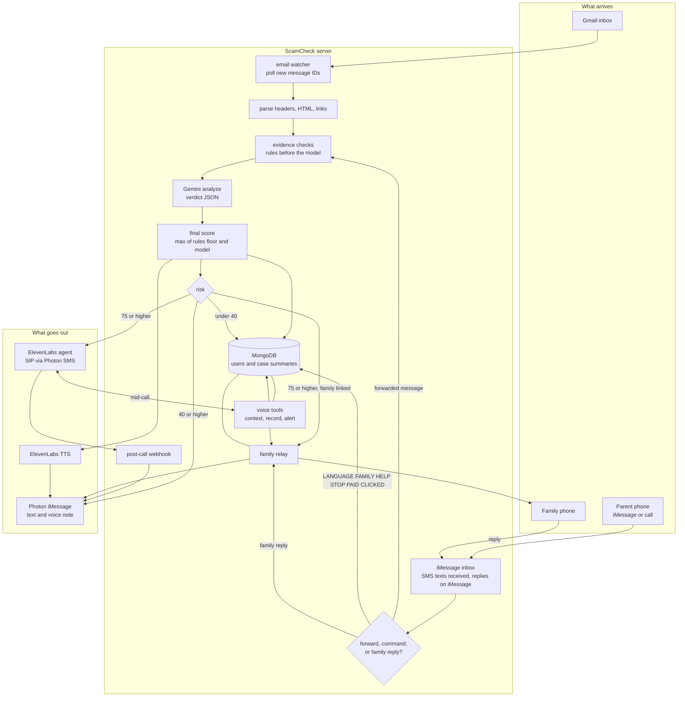

# ScamCheck

ScamCheck watches for scams, warns parents in their own language, and brings the family in to help. The AI catches it; the family decides.

Built for DubHacks '26. It lives where older parents and immigrant families already are: Gmail, iMessage, and a phone call. They do not open an app or learn a new tool.

## What it does

1. **Proactive email scanning.** After a one-time read-only Gmail connect, ScamCheck polls the inbox. The user does nothing.
2. **Outbound warning call.** A high-risk email triggers a spoken warning in the user's language, then a text and a voice note.
3. **Ask anything.** Messages ScamCheck cannot read (iMessage, SMS, WhatsApp, screenshots) are forwarded to the ScamCheck contact, or the user calls and describes them. They get a verdict by iMessage, with a voice note, or spoken on the call.
4. **Two-way family loop.** On a risky item, a linked family member gets an iMessage alert with no original content. Their reply is relayed back as iMessage text and a voice note.
5. **Memory across channels.** Cases are stored as short summaries. A later call or text can refer to an email that was already flagged, and to the same scam hitting another person in the family.

Identity is the phone number in E.164, shared across iMessage, calls, and family links. A Gmail account is attached to that user.

| Source | Automatic scan? | How ScamCheck handles it |
|---|---|---|
| Gmail | Yes, read-only, after OAuth | Poll every 15–20 seconds |
| iPhone texts / iMessage | No — iOS does not allow it | User forwards to the ScamCheck contact, or calls |
| Personal WhatsApp | No — no API for personal chats | User forwards a screenshot or the text, or calls |
| Android SMS | No — Android does not let third-party apps read other apps' private SMS | User forwards the message, or calls. ScamCheck replies on iMessage |
| Outlook | Not in this build | — |

Photon gives ScamCheck an iMessage line for texts and an SMS number for phone calls. Outbound texts go on iMessage. The SMS number is for voice only, through ElevenLabs SIP. ScamCheck does not read the user's other conversations. An iMessage needs an eligible iMessage recipient.

## Architecture



Rules run first. Any high finding sets a floor of 75, so the model cannot talk a clear red flag down. Final score is the higher of that floor and the model score. Message bodies stay in memory for the check and are not written to the database.

### Email path

1. Poll `in:inbox newer_than:1d` and skip IDs already seen.
2. Fetch the message, parse headers and HTML, and extract links (visible text versus real href).
3. Run evidence checks, then Gemini, then `notifyEmail`.
4. High risk: iMessage alert, voice note, outbound call, and a family alert.
5. Medium risk: iMessage alert and a voice note.
6. Low risk: store a case summary and send nothing.

### Inbound text

First contact starts onboarding: language, consent (`YES`), a Gmail connect link, then an optional family contact. If the first message is already a forward, it is checked before onboarding continues.

A later forward gets a short "Checking…" reply, then the same evidence and analysis path, then text and a voice note. A photo attachment is read by Gemini and deleted after the check.

### Calls

Inbound and outbound calls use an ElevenLabs agent on the Photon SMS number over SIP. At the start of a call the agent loads `get_user_context` (name, language, recent cases, any pending flagged item). It records the case and can alert family. When the call ends, a signed webhook sends a short text follow-up. Transcripts are not stored.

### Family relay

The alert names the person and the scam type only. A reply is matched to the latest open case, sent back to the user, and saved as a short `familyResponse`. If the family member says the message is real, the case is marked `confirmed_real`.

## Risk policy

| Score | What the user gets |
|---|---|
| 75–100 | Outbound call, iMessage alert, voice note, family alert |
| 40–74 | iMessage alert and voice note |
| 0–39 | No message. Counted as a checked item |

ScamCheck never tells someone a message is safe, verified, legitimate, or official. The best outcome is **no red flags**. Every alert ends with: automated check — it can be wrong; verify with the company directly.

Evidence checks, before the model:

- SPF, DKIM, or DMARC failure
- Brand claimed in the message, From domain or link domain not an official domain (registrable domain, not a substring)
- Link text shows one domain and the href goes to another
- Lookalike domains (punycode, character swaps, brand buried in another domain)
- Reply-To on a different registrable domain
- New sender plus money or urgency language
- Gift cards, crypto, wire, passwords, "verify your account", small fees
- URL shorteners

## Stack

| Piece | Choice |
|---|---|
| Runtime | TypeScript, Node.js 20+ |
| Messaging | Photon 2.0 beta (`@photon-ai/api`) — iMessage for text; SMS number for voice calls |
| Model | Google Gemini Flash, JSON output, validated with zod |
| Voice notes | ElevenLabs text-to-speech |
| Calls | ElevenLabs Agents over SIP to the Photon SMS number |
| Email | Gmail API, `googleapis`, scope `gmail.readonly` |
| Database | MongoDB Atlas — users and case summaries only |

## Run it

```bash
npm install
cp .env.example .env
npm start
```

`npm start` listens on `PORT` (default 3000), serves the website at `/`, polls inbound iMessage and SMS when Photon is configured, and starts the Gmail poll when MongoDB and Google OAuth are configured. Replies go out on iMessage.

```bash
npm test          # unit tests
npm run typecheck
npm run fixtures  # fixture set: caught, missed, false alarms
```

### HTTP routes

| Method | Path | Purpose |
|---|---|---|
| GET | `/` | Website: create an account, add a parent, read metrics |
| GET | `/healthz` | Liveness |
| POST | `/signup`, `/login`, `/logout` | Account session |
| GET | `/app` | Parents added to the signed-in account, with metrics after they have agreed |
| POST | `/app/parents`, `/app/parents/remove` | Add or remove a parent number. Adding sends one iMessage; the card shows Photon delivery status |
| GET | `/connect/gmail?u=` | Consent page for Gmail connect |
| GET | `/connect/gmail/start` | Redirect to Google OAuth |
| GET | `/connect/gmail/callback` | Store the encrypted refresh token |
| POST | `/voice/tools/:name` | `get_user_context`, `record_case`, `alert_family` |
| POST | `/voice/post-call` | Signed ElevenLabs webhook → text follow-up |

Voice tool requests must send `x-scamcheck-secret`.

### Commands

Any time after onboarding: `LANGUAGE`, `FAMILY`, `HELP`, `STOP`, `PAID`, `CLICKED`.

`STOP` revokes the Gmail token and deletes the user and their cases. `PAID` and `CLICKED` tell the user to call their bank using the number on their card, alert family, and offer a call.

### Environment

Copy `.env.example`. Do not commit `.env`.

| Variable | Used for |
|---|---|
| `PORT`, `PUBLIC_BASE_URL` | Server and the Gmail connect link |
| `MONGODB_URI` | Users and cases |
| `TOKEN_ENCRYPTION_KEY` | Gmail refresh tokens at rest |
| `GEMINI_API_KEY`, `GEMINI_MODEL` | Analysis |
| `ELEVENLABS_API_KEY`, `ELEVENLABS_TTS_MODEL_ID`, `ELEVENLABS_VOICE_ID` | Voice notes |
| `ELEVENLABS_AGENT_ID`, `ELEVENLABS_PHONE_NUMBER_ID` | Outbound warning calls |
| `ELEVENLABS_WEBHOOK_SECRET` | Post-call signature |
| `VOICE_TOOL_SECRET` | Mid-call tool auth |
| `PHOTON_PROJECT_ID`, `PHOTON_PROJECT_SECRET`, `PHOTON_API_KEY` | Photon iMessage text send and receive. Voice uses the Photon SMS number |
| `PHOTON_AGENT_USER_ID` | Optional iMessage agent user; otherwise discovered from the project |
| `PHOTON_SMS_AGENT_USER_ID` | Optional. Not used for outbound text. Voice uses the ElevenLabs number on the Photon SMS line |
| `GOOGLE_CLIENT_ID`, `GOOGLE_CLIENT_SECRET`, `GOOGLE_REDIRECT_URI` | Gmail OAuth |
| `SAFE_BROWSING_API_KEY` | Optional URL check |
| `EMAIL_POLL_SECONDS` | Inbox poll interval, default 20 |
| `DEMO_GMAIL_REFRESH_TOKEN` | `scripts/demoSend.ts` only; needs `gmail.insert`, not the app's read-only scope |

Gmail OAuth is a testing-mode Google Cloud app. Add the demo account as a test user.

Voice setup follows the Photon ElevenLabs cookbook: an SMS number (voice does not run on a shared iMessage line), a Photon voice profile with SIP, the number imported into ElevenLabs as a SIP trunk, and the agent assigned to that number. Inbound destination is ElevenLabs; outbound uses the Photon SIP address with TLS.

## What is stored

Cases keep a verdict, score, scam type, claimed brand, sender domain, a one-sentence English summary, how the user was notified, and an optional short family reply. They do not keep raw email or message text, images, audio, or call transcripts. Logs keep ids, verdicts, and latencies — not message content, tokens, or full phone numbers.

Family alerts go only to numbers the user added, and they never include the original message.

## Layout

```
src/
  index.ts            server, routes, schedulers
  channels/           Photon send, receive, voice notes
  email/              OAuth, polling, HTML parse, token encryption
  core/               evidence, Gemini, notify, onboarding, family relay
  voice/              outbound call, mid-call tools, post-call webhook
  db/                 MongoDB users and cases
scripts/              fixture runner and demo email
tests/                review fixes
docs/veyzl-log.md     audit finding, fix, and PR
```
